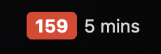
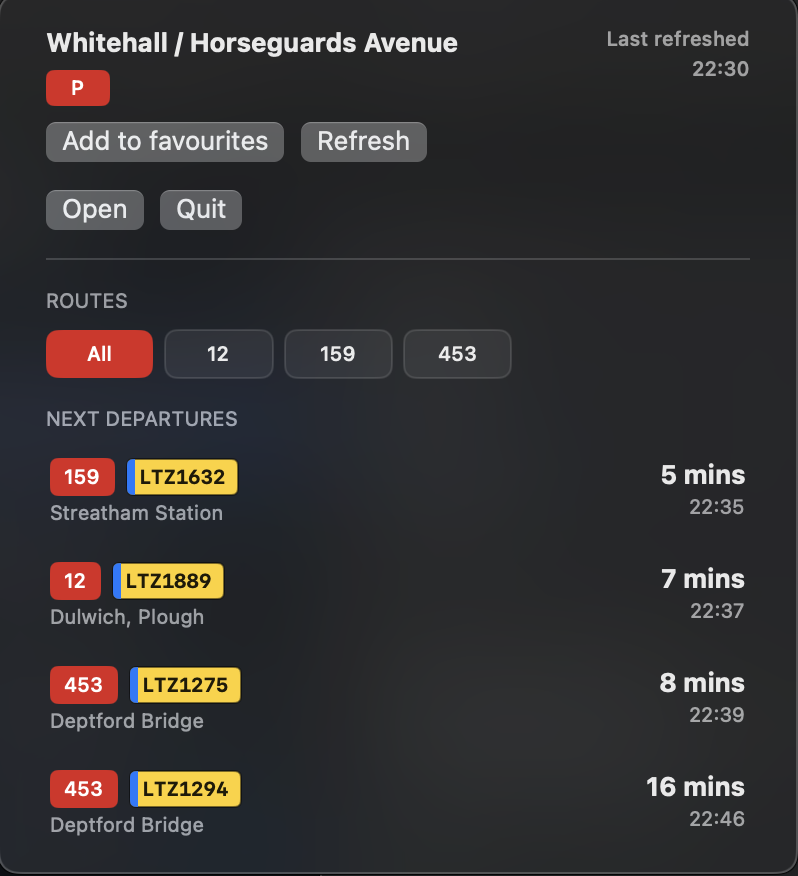
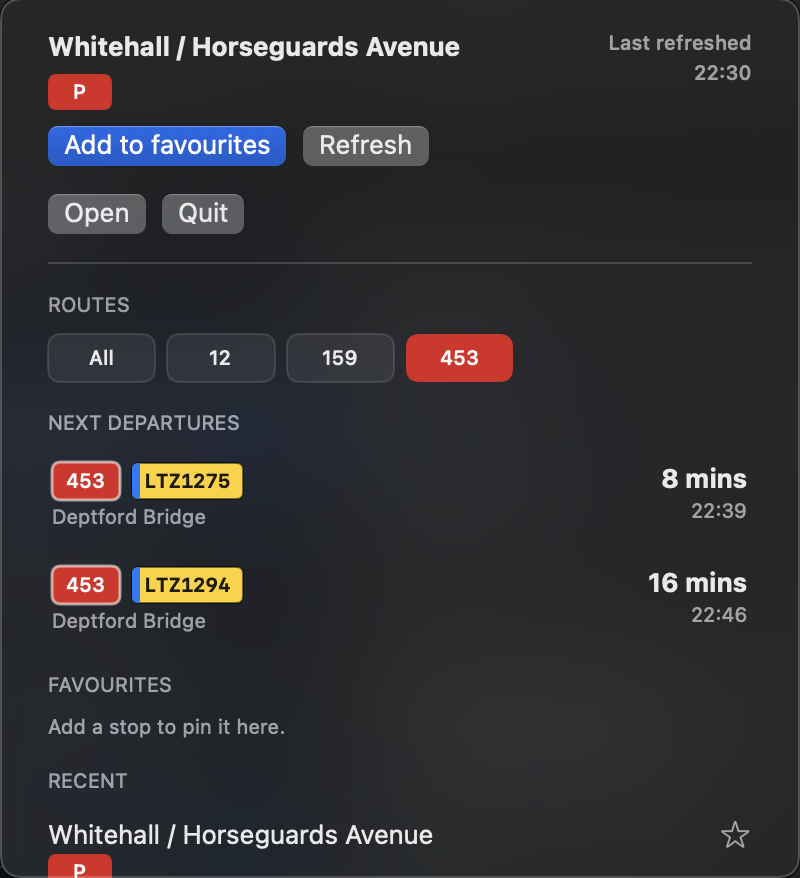
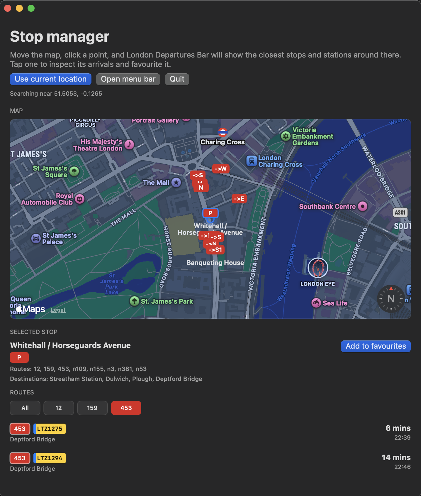

# London Departures Bar

London Departures Bar is a lightweight macOS menu bar app for live public transport departures around London. It keeps the next service visible in the menu bar and opens into a compact departures board for nearby stops and stations.



## What It Does

- Shows the next live departure directly in the macOS menu bar.
- Uses transport-coloured badges for buses, trams, Tube lines, DLR, Overground, Elizabeth line, and National Rail.
- Opens a two-column popover with the selected stop and live departures on the left, and Favourites, Recent, and Nearby tabs on the right.
- Filters departures by route, destination, or National Rail platform.
- Lists all known routes for each stop, with its "Towards" destination or compass direction when TfL provides it.
- Displays bus vehicle IDs as plate-style labels when TfL provides them.
- Opens a bus departure into a route map and ordered stop list, highlighting the selected bus, your stop, and its next predicted stop. Positions refresh every 30 seconds and are labelled as estimates when TfL supplies only arrival predictions.
- Saves selected stops, favourites, recent stops, cached nearby stops, and active filters between launches.
- Refreshes live data every 60 seconds and updates countdown labels every 15 seconds.





## Stop And Station Discovery

- Finds nearby TfL stops and stations from the TfL StopPoint API.
- Includes buses, trams, Underground, DLR, Overground, Elizabeth line, and rail stations exposed by TfL.
- Provides a standalone map window for exploring stops around any clicked point.
- Uses your current location in the Nearby tab to show up to 20 stops within 1 km, closest first, with straight-line distances.
- Can request the current macOS location permission to jump the map to nearby transport.
- Shows route and destination summaries for the selected stop.
- Lets you favourite stops from the popover or map window.



## Live Data Sources

- TfL arrivals come from the TfL StopPoint arrivals endpoint.
- Route metadata comes from the TfL StopPoint route endpoint.
- National Rail departures use Huxley as a fallback when TfL does not return rail predictions.

## Privacy

- Location lookup is optional and starts when you select `Nearby`, click `Refresh location`, or click `Use current location` in the map window.
- The Nearby tab requests a single location fix. It does not track movement or store your location between launches.
- Nearby-stop searches send the selected map coordinate or current-location coordinate to the TfL StopPoint API.
- National Rail fallback departures are requested from Huxley when TfL does not return rail predictions.
- Selected stops, favourites, recents, cached nearby stops, and active filters are stored locally in macOS `UserDefaults`.
- The app does not include analytics, advertising, or a developer-operated backend.

## Requirements

- macOS 14 or later
- Swift 6 toolchain
- Network access to TfL APIs
- Network access to Huxley for National Rail fallback data

## Run From Source

Open the folder in Xcode as a Swift package, or run:

```bash
swift run
```

## Build The App Bundle

To refresh the local `London Departures Bar.app` bundle with a release build:

```bash
./scripts/build-app.sh
open -n "London Departures Bar.app"
```

The build script compiles the Swift package in release mode, copies the executable into `London Departures Bar.app`, and applies an ad-hoc code signature.

## Build A DMG

To build a local DMG:

```bash
./scripts/build-dmg.sh v1.0.0
```

The DMG and checksum are written to `dist/`:

```text
dist/London-Departures-Bar-1.0.0.dmg
dist/London-Departures-Bar-1.0.0.dmg.sha256
```

## Publish A GitHub Release

GitHub Actions builds and attaches the DMG automatically when a version tag is pushed:

```bash
git tag -a v1.0.0 -m "v1.0.0"
git push origin v1.0.0
```

The release workflow can also be run manually from GitHub Actions with an existing `v*` tag.

The generated release DMG is ad-hoc signed. macOS may warn that the app is from an unidentified developer until a Developer ID signed and notarized release is available.

## Usage

Launch `London Departures Bar.app`, then click the menu bar item to open the departures popover. Click outside the popover to dismiss it. Use the Favourites, Recent, and Nearby tabs in the right column to choose a stop and update the stop, routes, and departures on the left. Each column scrolls independently, and selecting a favourite keeps the list in its existing order. Type in the filter box above Favourites or Recent to narrow the list by stop name, area, stop code, direction, or exact route number (for example `36`), then press Return to open the top match or Esc to clear the filter.

Select Nearby to find stops around your current location. Allow macOS location access when prompted. Stops appear closest first with approximate straight-line distances, rather than walking distances. Click Refresh location to search again after moving. Searching does not change the selected stop until you click a result. If location access is denied, enable it in System Settings > Privacy & Security > Location Services, then retry. Open the map window to explore stops around any point.

Click any bus departure row, including its number plate or arrival time, to open its stops and position. Use `Locate bus` to return to the selected bus after moving the map. If TfL has no prediction for that vehicle, the detail window shows that its position is unavailable.

Click a route, destination, or platform badge in the filters section to filter the departure list. Click the badge again to remove that filter, or use `All` to show every available departure for the selected stop.

## Project Layout

- `Sources/LondonDeparturesBar/main.swift` contains the app entry point, store, API models, menu bar controller, popover UI, and map window.
- `scripts/build-app.sh` builds and signs the local app bundle.
- `scripts/build-dmg.sh` builds a local compressed DMG in `dist/`.
- `Assets/AppIcon.svg` is the editable app icon, `Assets/AppIcon.png` is its full-resolution preview, and `Assets/AppIcon.icns` contains the macOS icon sizes.
- `Assets/menu-bar-status.png`, `Assets/departures-popover.png`, `Assets/route-filter-popover.png`, and `Assets/stop-manager-map.png` provide README screenshots.
- `Packaging/Info.plist` provides the macOS app bundle metadata.

## Name

The app used to be called `BusBar`. `London Departures Bar` better describes the current app: a menu bar departures board for London transport, not just a bus tracker.

The Swift package and executable target use `LondonDeparturesBar`, while the visible macOS app bundle is `London Departures Bar.app`.

## Public Release Note

The default stops are neutral central London examples. For a public repository, start from a clean working tree or a fresh local repository so old private stop data is not present in Git history.

Release builds should be signed and notarized before distribution. The local build script uses an ad-hoc signature for development builds.
